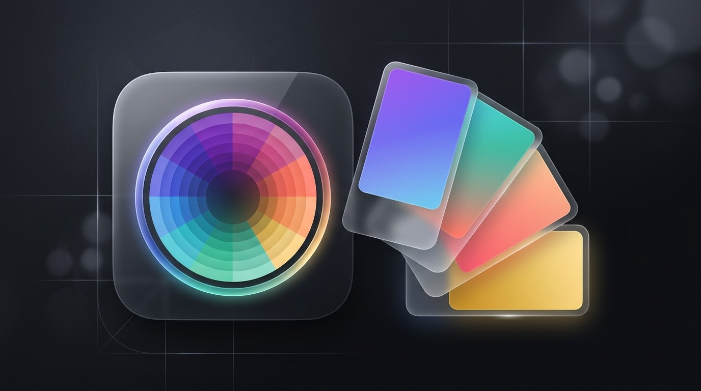
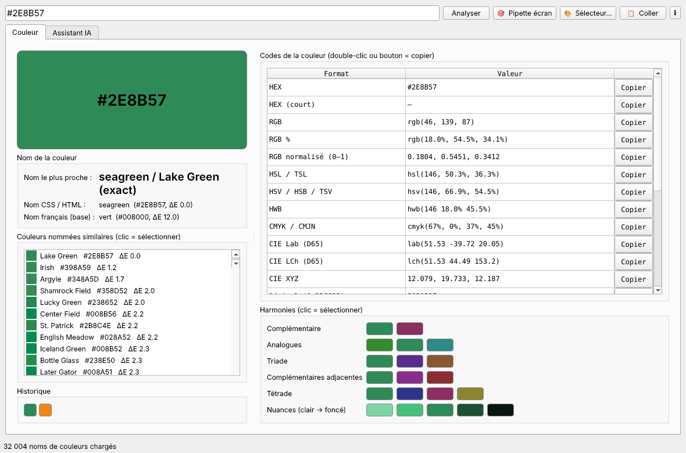

<p align="center"></p>

# gsColorName

**Trouvez le nom d'une couleur et tous ses codes** : HEX, RGB, CMJN, HSL, Lab, décimal, etc.
Application de bureau (Qt / PySide6) pour **Linux**, **Windows** et **macOS**, avec pipette écran et assistant IA
(**LM Studio** en local ou **OpenRouter**).



---

## Sommaire

- [Fonctionnalités](#fonctionnalités)
- [Installation](#installation)
- [Utilisation](#utilisation)
- [Formats acceptés en saisie](#formats-acceptés-en-saisie)
- [Assistant IA](#assistant-ia)
- [Configuration et données](#configuration-et-données)
- [Exécuter depuis les sources](#exécuter-depuis-les-sources)
- [Construire les installateurs](#construire-les-installateurs)
- [Structure du projet](#structure-du-projet)
- [Limites connues](#limites-connues)
- [Licence](#licence)

---

## Fonctionnalités

| Fonction | Détail |
|---|---|
| **22 formats de sortie** | HEX, HEX court, RGB, RGB %, RGB 0–1, HSL/TSL, HSV/HSB, HWB, CMJN, CIE Lab, LCh, XYZ, décimal, 0x, décimal BGR (Win32/VBA), ARGB, RGB565, binaire, QColor, UIColor, luminance relative, contraste WCAG |
| **Nom de la couleur** | ~32 000 noms ([color-name-list](https://github.com/meodai/color-name-list)), 148 noms CSS, ~70 noms français ; correspondance par **ΔE CIEDE2000** avec un indice de proximité |
| **Couleurs similaires** | Les 12 couleurs nommées les plus proches, cliquables |
| **Pipette écran** | `Ctrl+P` — portail XDG sous Wayland (GNOME/KDE), superposition avec loupe ×12 sous X11/Windows |
| **Sélecteur** | Boîte de dialogue Qt (roue chromatique, curseurs) |
| **Harmonies** | Complémentaire, analogues, triade, complémentaires adjacentes, tétrade, nuances |
| **Historique** | 16 dernières couleurs, conservées entre les sessions |
| **Assistant IA** | Nom FR/EN, équivalents approximatifs Pantone/RAL/NCS, remarques d'impression, associations ; questions libres |
| **Presse-papiers** | Double-clic ou bouton « Copier » sur chaque format ; `Ctrl+Shift+V` analyse le presse-papiers |

---

## Installation

Téléchargez l'installateur depuis la page **[Releases](https://github.com/gsavard/gsColorName/releases)**.

### Windows 10/11 (64 bits)
1. Téléchargez `gsColorName-<version>-win64-setup.exe`.
2. Lancez-le. Par défaut, l'installation se fait **sans droits administrateur** (dans le profil utilisateur) ;
   l'assistant permet aussi une installation pour tous les utilisateurs.
3. SmartScreen peut afficher un avertissement (exécutable non signé) : *Informations complémentaires → Exécuter quand même*.

Installation silencieuse (déploiement PDQ, Intune, GPO) :
```powershell
gsColorName-1.0.0-win64-setup.exe /VERYSILENT /SUPPRESSMSGBOXES /NORESTART /ALLUSERS
```
Désinstallation silencieuse : `"%ProgramFiles%\gsColorName\unins000.exe" /VERYSILENT`
(installation par utilisateur : `%LOCALAPPDATA%\Programs\gsColorName\unins000.exe`).

### macOS 11+ (Apple Silicon ou Intel)
1. Téléchargez `gsColorName-<version>-macos-arm64.dmg` (Apple M1/M2/M3/M4) ou `…-macos-x86_64.dmg` (Intel).
2. Ouvrez le `.dmg` et glissez **gsColorName** dans **Applications**.
3. Au premier lancement, l'app n'est pas notariée par Apple : macOS la bloque.
   - Ouvrez **Réglages Système → Confidentialité et sécurité**, puis cliquez sur **Ouvrir quand même** ; **ou**
   - dans le Terminal : `xattr -dr com.apple.quarantine /Applications/gsColorName.app`

Sur macOS, les raccourcis `Ctrl` deviennent `⌘` : `⌘P` pour la pipette.

### Debian / Ubuntu / Mint (.deb)
```bash
sudo apt install ./gscolorname_1.0.0_amd64.deb
```

### Fedora / RHEL / openSUSE (.rpm)
```bash
sudo dnf install ./gscolorname-1.0.0-1.x86_64.rpm
```

Après l'installation, **gsColorName** apparaît dans le menu des applications. Vous pouvez aussi le lancer
avec la commande `gscolorname`.
Les fichiers sont installés dans `/opt/gscolorname`, avec un lien `/usr/bin/gscolorname`, un fichier `.desktop` et des icônes (16 à 512 px).

Option de lancement : `gscolorname --no-splash` désactive l'écran de démarrage.

Désinstallation : `sudo apt remove gscolorname` ou `sudo dnf remove gscolorname`.

---

## Utilisation

1. **Saisissez** un code ou un nom dans la barre du haut, puis appuyez sur `Entrée`, **ou**
2. cliquez sur **🎯 Pipette écran** (`Ctrl+P`) et cliquez n'importe quel pixel, **ou**
3. cliquez sur **🎨 Sélecteur…**, **ou**
4. copiez un code ailleurs et cliquez sur **📋 Coller**.

L'onglet **Couleur** affiche :
- le **nom le plus proche**, avec son écart ΔE (< 1 : identique à l'œil, < 2 : quasi identique, < 5 : très proche) ;
- le nom **CSS** et le nom **français** de base les plus proches ;
- la liste des **couleurs nommées similaires** ;
- le **tableau des codes** (double-clic pour copier) ;
- les **harmonies** (cliquez une pastille pour l'analyser).

### Pipette

| Environnement | Méthode |
|---|---|
| Linux Wayland (Fedora GNOME, KDE Plasma) | Portail système `org.freedesktop.portal.Screenshot.PickColor`, qui affiche le curseur pipette natif |
| macOS | Pipette native (`NSColorSampler`) : loupe système, aucune autorisation « Enregistrement de l'écran » requise |
| Linux X11, Windows | Capture plein écran avec loupe : **clic** pour choisir, **flèches** pour ajuster au pixel près, **Entrée** pour valider, **Échap** pour annuler |

Sous Wayland, la capture directe de l'écran est interdite par conception, donc l'application passe toujours
par le portail. Si celui-ci est indisponible, elle tente la méthode de capture.

---

## Formats acceptés en saisie

| Exemple | Interprétation |
|---|---|
| `#1E90FF`, `1e90ff`, `#abc`, `0x1E90FF`, `#1E90FF80` | Hexadécimal (canal alpha ignoré) |
| `rgb(30, 144, 255)`, `rgb(12%, 56%, 100%)` | RGB |
| `255 128 0`, `255,128,0`, `0.1 0.5 0.9` | 3 nombres = RGB (0–255 ou 0–1) |
| `cmyk(88,44,0,0)`, `cmjn(88%,44%,0%,0%)`, `0,100,100,0` | CMJN (4 nombres = CMJN) |
| `hsl(210,100%,56%)`, `tsl(...)` | HSL |
| `hsv(210,88%,100%)`, `hsb(...)`, `tsv(...)` | HSV / HSB |
| `hwb(210 12% 0%)` | HWB |
| `lab(59.4 10 -63.4)`, `lch(59.4 64.2 278.9)` | CIE Lab / LCh (D65) |
| `2003199`, `dec:255` | Entier décimal 0xRRGGBB (utilisez `dec:` pour lever l'ambiguïté) |
| `bgr:16748574` | Décimal BGR (COLORREF Windows, VBA, Access) |
| `QColor(30,144,255)` | Qt |
| `dodgerblue`, `rebeccapurple` | Nom CSS |
| `bleu roi`, `bordeaux`, `vert sapin` | Nom français |
| `Congressional Navy` | Nom anglais (base color-name-list) |

> ⚠ Une chaîne de 6 chiffres comme `123456` est interprétée comme **hexadécimale**. Pour un décimal, écrivez `dec:123456`.

---

## Assistant IA

L'onglet **Assistant IA** utilise l'API compatible OpenAI (`/v1/models`, `/v1/chat/completions`).

### LM Studio (local, gratuit, hors ligne)
1. Dans LM Studio : téléchargez un modèle (par ex. Qwen 3, Gemma 3, Mistral).
2. Onglet **Developer** → **Start Server** (port 1234 par défaut).
3. Dans gsColorName : fournisseur **LM Studio (local)**, URL `http://localhost:1234/v1`,
   puis cliquez sur **Lister les modèles** et **Tester**.

Le serveur LM Studio peut tourner sur une autre machine du réseau : activez *Serve on Local Network* et
indiquez `http://<ip>:1234/v1`.

### OpenRouter
1. Créez une clé sur <https://openrouter.ai/keys>.
2. Fournisseur **OpenRouter**, collez la clé `sk-or-v1-…`, ou définissez la variable d'environnement
   `OPENROUTER_API_KEY`.
3. **Lister les modèles**, puis choisissez-en un (par ex. `openai/gpt-4o-mini`, `anthropic/claude-sonnet-4.5`, `google/gemini-2.5-flash`).

### Fonctions
- **🔎 Demander le nom de la couleur actuelle** : envoie les codes de la couleur et les noms trouvés localement.
  Le modèle répond avec le nom français, le nom anglais, une description, des équivalents **approximatifs**
  Pantone/RAL/NCS, des remarques d'impression et 3 couleurs associées.
- **Question libre** : par ex. « Quel Pantone pour une enseigne extérieure ? » ou « Propose une palette de 5 couleurs pour un site web. »
- Les codes **HEX cités dans la réponse** apparaissent sous forme de pastilles cliquables.
- Les blocs `<think>…</think>` des modèles de raisonnement sont masqués.

> Les équivalences Pantone, RAL et NCS sont des **estimations du modèle**, et non des données officielles.

---

## Configuration et données

| Élément | Linux | Windows |
|---|---|---|
| Préférences (fournisseur, URL, modèle, historique, dernière couleur) | `~/.config/gsColorName/gsColorName.conf` | Registre `HKCU\Software\gsColorName\gsColorName` |

Sur macOS : `~/Library/Preferences/com.gscolorname.gsColorName.plist`.

Par défaut, la clé OpenRouter n'est **pas** enregistrée. Si vous cochez « Mémoriser la clé API », elle est
stockée **en clair** dans les préférences ci-dessus.

Aucune donnée n'est envoyée sur Internet sauf lorsque vous utilisez l'assistant IA avec OpenRouter.

---

## Exécuter depuis les sources

Prérequis : Python 3.10 ou plus récent.

```bash
git clone https://github.com/gsavard/gsColorName.git
cd gsColorName
./run.sh                 # Linux : crée .venv et installe les dépendances au 1er lancement
./install-desktop.sh     # (optionnel) ajoute un raccourci au menu, pointant vers les sources
```
Windows : `run.bat`.

Dépendances : `PySide6` ; `jeepney` sous Linux (D-Bus, pour la pipette Wayland) ; `pyobjc-framework-Cocoa` sous macOS (pipette native).
Sur macOS, `./run.sh` fonctionne aussi.

Tests :
```bash
pip install pytest && pytest -q tests
```

---

## Construire les installateurs

Voir **[docs/BUILD.md](docs/BUILD.md)** pour le détail. En résumé :

| Cible | Commande | Résultat |
|---|---|---|
| `.deb` + `.rpm` | `packaging/linux/build-packages.sh` | `dist/gscolorname_<v>_amd64.deb`, `dist/gscolorname-<v>-1.x86_64.rpm` |
| Windows | `powershell packaging\windows\build.ps1` | `dist\gsColorName-<v>-win64-setup.exe` |
| macOS | `packaging/macos/build-dmg.sh` | `dist/gsColorName-<v>-macos-<arm64\|x86_64>.dmg` |
| Tout, automatiquement | `git tag v1.0.0 && git push --tags` | GitHub Actions publie une *Release* avec les installateurs (Windows, .deb, .rpm, 2 × .dmg) et `SHA256SUMS.txt` |

---

## Structure du projet

```
gsColorName/
├── gscolorname.py          # Interface Qt (fenêtre principale, onglets)
├── colorcore.py            # Conversions, analyse de saisie, ΔE2000, base de noms
├── picker.py               # Pipette : portail XDG (Wayland) + superposition avec loupe
├── llm.py                  # Client LM Studio / OpenRouter (stdlib urllib)
├── version.py              # Numéro de version unique
├── data/colornames.json    # ~32 000 noms (color-name-list, MIT)
├── assets/                 # Icône (png, ico, icns) et bannière / écran de démarrage
├── packaging/
│   ├── gscolorname.spec    # PyInstaller (commun Linux/Windows/macOS)
│   ├── linux/              # build-packages.sh, .desktop, spec RPM
│   ├── windows/            # build.ps1, script Inno Setup, infos de version
│   └── macos/              # build-dmg.sh (.app + .dmg)
├── tests/                  # pytest
├── .github/workflows/      # CI : tests + installateurs + Release
├── run.sh / run.bat        # Lancement depuis les sources
└── install-desktop.sh      # Raccourci de menu (mode sources)
```

---

## Limites connues

- La conversion **RGB → CMJN** est mathématique, sans profil ICC. Pour l'impression, validez avec le profil
  de l'imprimeur (FOGRA39, GRACoL, etc.).
- Il n'y a pas de base Pantone ou RAL intégrée (ces nuanciers sont propriétaires). Seule l'IA en propose des approximations.
- Les installateurs ne sont pas signés : SmartScreen (Windows) peut afficher un avertissement, et Gatekeeper (macOS) demande une confirmation (app signée ad hoc, non notariée).
- Sous Wayland, la pipette nécessite `xdg-desktop-portal` (présent par défaut sous GNOME et KDE).

---

## Licence

[MIT](LICENSE) © 2026 gsavard.
La base de noms provient de [meodai/color-name-list](https://github.com/meodai/color-name-list)
(MIT, voir `data/LICENSE-color-name-list.txt`).
